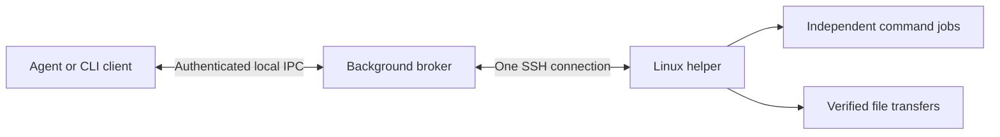

# persistent-ssh

**Authenticate once with a human, then reuse the SSH connection for agent work.**

[中文说明](README.zh-CN.md) · [Agent skill](SKILL.md) · [Authentication](docs/authentication.md) · [Platform support](docs/platforms.md) · [Related projects](docs/related-work.md)

`persistent-ssh` is a self-contained agent skill and Python command-line tool for
SSH hosts that require passwords, OTPs, push approval, or QR authentication.
It uses your installed OpenSSH client and existing SSH configuration. No SSH key,
saved password, pip package, MCP server, or privileged remote service is required.

A local background broker holds the authenticated connection. Short-lived CLI
clients submit commands and transfer files through it. Multiple agent chats can
reuse one profile without logging in for every operation.



## What it includes

- Native interactive SSH authentication; hidden local password/OTP entry.
- Named profiles with separate brokers, authentication state, tasks and sockets.
- Remote Bash jobs with exit codes, incremental stdout/stderr, cancellation and deadlines.
- Upload/download over the authenticated shell, even when SFTP is unavailable.
- Bounded transfer chunks, resume, SHA-256 verification and atomic publication.
- Windows Task Scheduler hosting; Linux systemd-user or tmux hosting; a macOS
  launchd backend whose lifecycle still needs real-machine verification.
- A root `SKILL.md` containing the operational workflow, bundled scripts, tests,
  examples, documentation and an MIT license.

This is a **skill plus CLI**, not an MCP implementation. It is not a new SSH
protocol and does not bypass MFA or keep expired authentication valid.

## Compatibility

Local Python **3.10+** and OpenSSH `ssh` are required. Windows needs ConPTY
(Windows 10 1809 or newer) and access to Task Scheduler. Linux needs a user
systemd manager or tmux. The Linux remote needs a usable POSIX login shell,
**Python 3.8+**, `/bin/bash`, writable temporary storage and `/proc`.
Remote tmux is preferred; detached jobs are used if it is unavailable.

**Not every SSH destination is supported.** Network appliances, Windows remotes,
forced-command accounts and gateways that prohibit a shell/Python need another
backend. No directory synchronization or atomic multi-client edit conflict
detection is provided. Read the [verified support matrix](docs/platforms.md).

## Install the complete skill

Download or clone this repository, then run:

```console
python scripts/install_skill.py
```

This copies the complete package into `$CODEX_HOME/skills/persistent-ssh`, or
`~/.codex/skills/persistent-ssh` when `CODEX_HOME` is unset. It does not create an
SSH connection. `--destination <directory>` supports another skill directory or
agent. The destination must be new; deliberate updates use `--replace` after
checking that an active broker is not relying on the old files.

You can also use the repository directly without installing. In the examples
below, run from the repository root or replace `scripts/ssh_manager.py` with its
absolute installed path. Agents can invoke **`$persistent-ssh`** after discovery.

## First connection

First configure and verify the destination normally with OpenSSH. The examples
assume an existing `lab-host` alias in `~/.ssh/config`; no credential is put here.
Host-key checking remains strict. A first-seen or changed host key must be verified
through a trusted channel and recorded using the normal SSH workflow.

```console
python scripts/ssh_manager.py --profile lab init --host lab-host
python scripts/ssh_manager.py --profile lab start
python scripts/ssh_manager.py --profile lab connect
python scripts/ssh_manager.py --profile lab status
python scripts/ssh_manager.py --profile lab auth-info
```

For a password or OTP, **the human runs this in their own interactive terminal**:

```console
python scripts/ssh_manager.py --profile lab auth
```

Input is hidden and sent only to the private local broker. No `--password` option
exists. Repeat for the next authentication prompt if needed. For an explicitly
requested empty response, use `auth --empty`.

For a scan/push flow, display the current authentication URL, complete the human
approval, and respond to its prompt. If the provider expects a known series of
empty responses, initialize with `--settings examples/scan-confirm.json`, adjust
its patterns to that provider, and run `confirm` **after** the human confirms.
The example is not a universal MFA recipe. See [authentication settings](docs/authentication.md).

When `status` becomes `ready`, verify the remote identity:

```console
python scripts/ssh_manager.py --profile lab ping
```

## Work and transfer files

```console
python scripts/ssh_manager.py --profile lab exec --cwd /srv/project --command "git status --short" --wait 10
python scripts/ssh_manager.py --profile lab exec --cwd /srv/project --script ./work/change.sh --wait 10
python scripts/ssh_manager.py --profile lab job JOB_ID --wait 10
python scripts/ssh_manager.py --profile lab upload ./work/fix.patch /tmp/fix.patch
python scripts/ssh_manager.py --profile lab download /tmp/results.json ./outputs/results.json
```

Each command has a separate shell. Set `--cwd` explicitly; use `--env-json` for
per-job variables. `--script` reads UTF-8 shell source locally without expanding
its `$variables` in the local shell. Commands and transfer operations reuse the
same connection. No new `scp`/`sftp` login is opened.

The JSON response contains a job ID, state, stdout/stderr, byte offsets and an
`exit_code` when available. The CLI's own success means it delivered a response;
check the remote exit code too. `--wait` observes for at most 25 seconds and does
not stop the job. `--timeout` sets an actual remote execution deadline.

```console
python scripts/ssh_manager.py --profile lab job JOB_ID --stdout-offset 8192 --stderr-offset 0
python scripts/ssh_manager.py --profile lab jobs
python scripts/ssh_manager.py --profile lab cancel JOB_ID
```

After a lost reply, inspect the recorded job ID before submitting again. Supply
the same `--job-id` only for an identical operation. Transfers resume matching
staging files after reconnecting. `--overwrite` is required to replace a file;
`upload --mkdirs` creates missing destination parents. File modes are preserved
when replacing an existing remote file, but ACLs/xattrs/ownership are not copied.

## Lifecycle

`start` starts the broker; `connect` starts authentication. Neither status checks
nor a crashed client trigger an automatic login loop. Client exit leaves the
broker and remote jobs alive. The local hosting task/service has no periodic
login trigger. Windows hosting has no execution time limit.

```console
python scripts/ssh_manager.py --profile lab disconnect --yes
python scripts/ssh_manager.py --profile lab shutdown --yes
```

These deliberate actions affect all clients sharing the profile. They do not
cancel detached remote jobs. Local sign-out/reboot, network loss, broker failure,
server shutdown and policy-enforced session expiry may require new authentication.
No guarantee is made that a connection survives a complete machine or session
restart. Remote temporary-directory cleanup can remove job records.

Private state is stored under `%LOCALAPPDATA%\PersistentSSH\PROFILE` on Windows
and `$XDG_STATE_HOME/persistent-ssh/PROFILE` (default `~/.local/state/...`) on POSIX.
Use `--runtime` for a private override. **Never commit runtime state or `auth.key`.**
See [SECURITY.md](SECURITY.md) for the trust boundary and credential handling.

## Tests and GitHub publication

```console
python -m unittest discover -s tests -v
```

Core tests are offline. The additional Linux/tmux integration fixture uses
synthetic password/OTP values and a local SSH-shaped process; it never contacts an
external host. It verifies the real PTY, broker, helper, files and job lifecycle,
but is not evidence of compatibility with every SSH/MFA provider.

The GitHub Actions offline matrix has passed on Windows, Linux and macOS with
Python 3.10, 3.12 and 3.14. macOS launchd lifecycle and provider-specific native
authentication still need separate verification. Actual observations are listed in
[platforms.md](docs/platforms.md). Similar existing projects and differences are
documented in [related-work.md](docs/related-work.md).

To publish, upload **this repository directory**, not a private runtime or the
parent workspace. The source archive contains no account-specific SSH config,
private keys, passwords, OTPs, live QR tokens or machine-specific validation logs.
See [CONTRIBUTING.md](CONTRIBUTING.md) for test and release expectations.

Licensed under [MIT](LICENSE).
